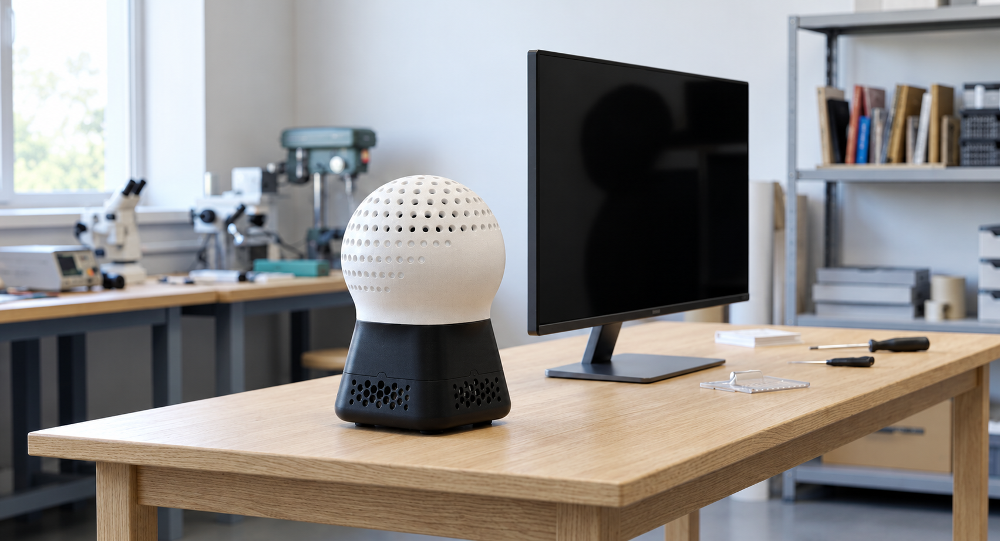
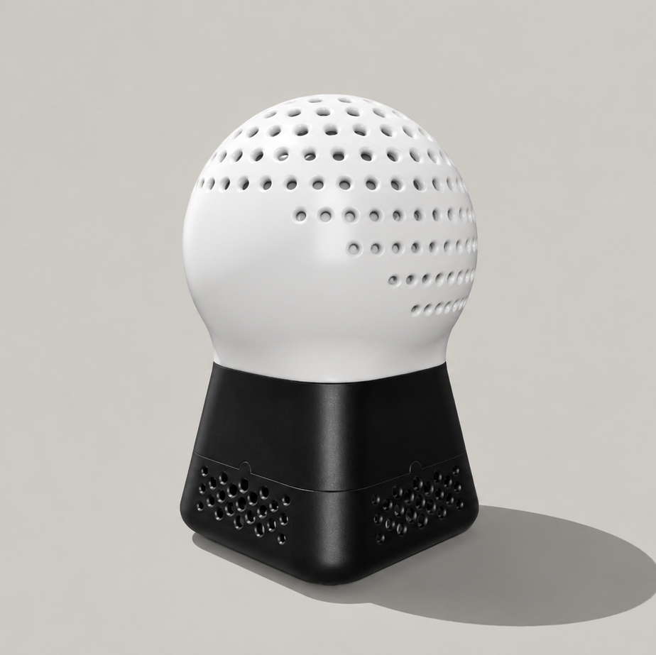
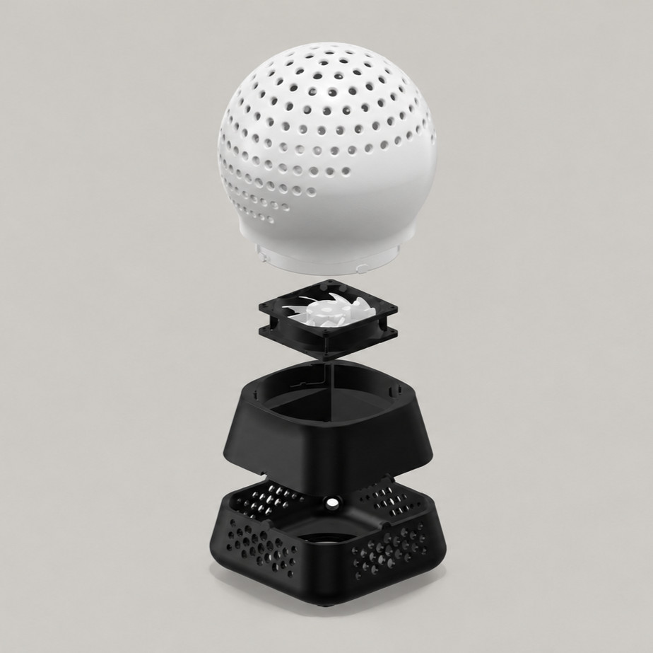
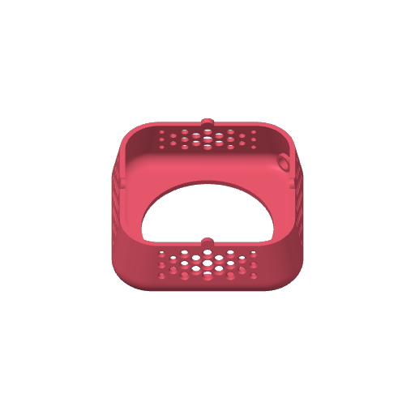
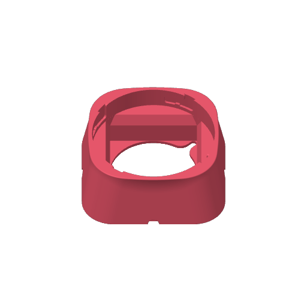
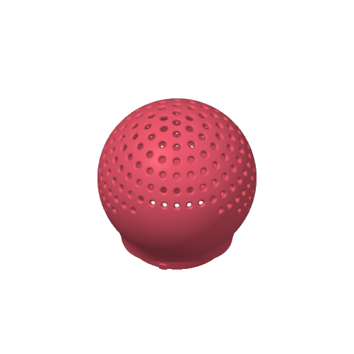

# EEG Cap Dryer
A 3D-printable stand for drying EEG caps after washing using a standard pc fan.

## Overview

Gel-based EEG caps must be washed after each use, as the conductive gel penetrates the fabric and the electrode holders. Once rinsed, the cap remains wet for hours and cannot be reused or stored until it is completely dry. 

The dryer is a perforated,  head-shaped dome on a ventilated base. The wet cap is pulled over the dome and a standard 80 mm fan pushes air up through the dome and the cap, speeding up the drying process.

| Assembled | Exploded |
|---|---|
|  |  |

## What you need

- ≈ 600 g of PLA
- One 80 mm fan, any model, and a power supply that matches its voltage
- Optional: glue for the base/adapter joint
- Optional: a panel-mount DC jack (5.5 × 2.1 mm) to plug the fan into a standard power adapter,
  e.g. [this set](https://www.amazon.it/dp/B0FBW3Z4N1)

## Printing

| Part | File | Time* | PLA* | |
|---|---|---|---|---|
| Base | [`base.stl`](stl/base.stl) | 5 h 05 m | 114 g |  |
| Adapter | [`adapter.stl`](stl/adapter.stl) | 2 h 25 m | 94 g |  |
| Dome | [`dome.stl`](stl/dome.stl) | 14 h 07 m | 346 g |  |

\*Measured with a Bambu Lab P1S; other printers will differ. Total: about 21.6 h and 555 g.

Load the STL files into your slicer (PrusaSlicer, Bambu Studio, …). They are already in print
orientation, so do not rotate them. Tested settings:

| Setting | Value |
|---|---|
| Material | PLA |
| Nozzle / layer height | 0.4 mm / 0.28 mm (0.20 mm first layer) |
| Walls | 2 |
| Infill | 7 % gyroid |
| Supports | tree supports, from the build plate only (the dome needs them) |
| Adhesion | brim, about 5 mm |
| Build volume | at least 190 × 190 × 170 mm |

**Bambu Lab:** open the project [`cad/cap_dryer.3mf`](cad/cap_dryer.3mf) instead. It has the three parts on
separate plates with the settings above already applied; select your printer and slice.

- **Cap size:** the dome is Ø170 mm, about 534 mm around, which suits caps larger than 54 cm. Scale the dome in the CAD
  for other sizes.
- **Size:** about 180 × 180 × 260 mm assembled.

## Assembly

1. Remove supports and brims.
2. Press the 80 mm fan into the square pocket at the bottom of the adapter, blowing upwards. It stays in place without glue or screws. Route its cable down through the base.
3. Power: connect the fan to a power supply that matches its voltage, either directly or through the optional DC jack.
4. Press the adapter onto the base until it locks. Glue is optional.
5. Put the dome on the adapter and turn it to engage the twist-lock.

## Credits

- Idea: [Leonardo Politi](https://github.com/LeonardoPoliti) (`leonardo.politi3@unibo.it`)
- Design: Samuele Sapio (`samuelesapio02@gmail.com`); Sofia Di Stefano (`sofiadistefano194@gmail.com`)

## Licence

[CC BY-NC-SA 4.0](LICENSE.md): free to build, use, and adapt for non-commercial purposes, with credit and under
the same licence. Commercial use needs the authors' permission.
